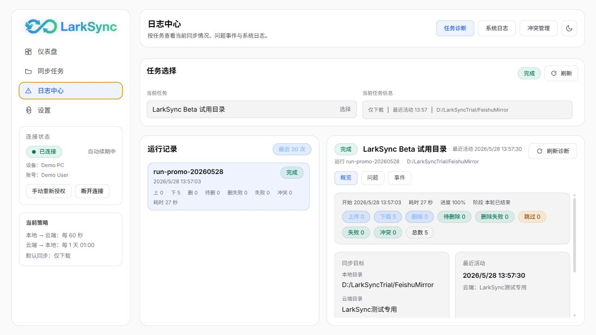

# LarkSync

<p align="center">
  
</p>

**把飞书 / Lark 云文档同步到本地，让你的编辑器、知识库和 AI 都能直接使用。**

LarkSync 是 Windows / macOS 常驻桌面应用。它将云文档转成 Markdown、下载图片和附件，也支持把本地修改同步回云端。继续在飞书协作，同时拥有可搜索、可编辑的本地资料。

[下载安装包](https://github.com/gooderno1/LarkSync/releases) · [快速开始](docs/QUICK_START.md) · [通过 AI 使用](docs/AI_GUIDE.md) · [反馈问题](https://github.com/gooderno1/LarkSync/issues)

> **V1.1.1 正式版**（2026-10-27）：修复导入转换及本地读写异常在后续同步成功后仍残留告警的问题，兼容历史记录并保留失败与恢复证据。提供 Windows、Apple Silicon 和 Intel 安装包，详见 [V1.1.1 发布说明与下载](https://github.com/gooderno1/LarkSync/releases/tag/v1.1.1)。

## 它能帮你做什么

| 你的需求 | LarkSync 提供的能力 |
| --- | --- |
| 让 Codex、WorkBuddy 读取飞书知识库 | 先同步到本地，AI 按需读取 Markdown 和文件，减少重复访问云端 |
| 用 Obsidian / VS Code 整理资料 | 保留目录结构、图片相对路径和云端修改时间 |
| 本地编辑，飞书继续协作 | 仅下载、仅上传、双向同步；文档和子文件夹可单独设置方向 |
| 管理多个账号的资料 | 账号、任务和凭据隔离；多个账号同时运行 |
| 知道同步是否成功 | 运行记录、文件级诊断、冲突处理与问题中心；网络、转换及本地读写异常按同文件、同方向的后续成功证据自动结案，兼容历史残留告警 |
| 看懂当前同步在做什么 | 总览、任务列表、详情、活动管理及设置统一展示阶段、处理数量、已用时间和等待原因；顶栏与托盘包含扫描及收尾状态 |
| 直接告诉 AI 建立或维护任务 | 配置预览、扫码授权、目录发现、创建、修改、暂停、恢复、运行及诊断 |



*截图展示同步结果，当前版本的界面布局可能有所调整。*

## 开始使用

1. 在 [V1.1.1 发布页](https://github.com/gooderno1/LarkSync/releases/tag/v1.1.1) 选择 Windows `LarkSync-Setup-v1.1.1.exe`，或匹配 Apple Silicon（`arm64`）/ Intel（`x86_64`）的 macOS DMG；可使用同名 `.sha256` 校验下载文件。macOS 首次打开的系统放行步骤见 [快速开始](docs/QUICK_START.md)。
2. 启动应用，点击“开始扫码连接”。首次通常需要先扫码创建个人应用，再扫码授权账号；无需安装 `lark-cli`。组织限制自动注册时，使用手动添加应用入口。
3. 选择飞书文件夹和本地目录，创建一个**仅下载**任务。第一次建议从少量文档开始。
4. 确认运行成功，并在本地看到 Markdown 和资源文件，再交给 AI 阅读或配置更多任务。

详细流程见 [快速开始](docs/QUICK_START.md)，授权问题见 [账号与 OAuth 指南](docs/OAUTH_GUIDE.md)。

## 让 AI 帮你配置和管理

把本仓库链接发给 Codex 或 WorkBuddy，可以直接这样说：

> 请阅读 https://github.com/gooderno1/LarkSync 的 README 和 docs/AI_GUIDE.md，帮我安装适合当前系统的版本并配置 LarkSync 技能。把我指定的飞书文件夹同步到指定本地目录，先仅下载、关闭删除联动；列出缺少的信息，预览配置后按我的授权建立任务，并确认首次同步结果。

安装 [通用 Skill](integrations/skills/larksync/SKILL.md) 后，可继续通过对话操作：

- “把这个飞书文件夹同步到 `D:/Knowledge/Team`，排除 `私人资料`。”
- “暂停团队知识库任务，其他任务继续。”
- “把这个任务的 `参考资料` 子文件夹设为仅下载。”
- “检查刚才同步失败的文件，告诉我需要处理什么。”

**Codex**：安装 `integrations/skills/larksync` 到用户技能目录 `~/.agents/skills/larksync`，重新加载技能。**WorkBuddy**：将完整技能目录放入项目的 `.codebuddy/skills/larksync`，或在技能界面导入 [V1.1.1 通用技能包](https://github.com/gooderno1/LarkSync/releases/download/v1.1.1/LarkSync-Agent-Skill-1.1.1.zip)。客户端识别和调用步骤见 [AI 使用指南](docs/AI_GUIDE.md)。

应用负责保存凭据和执行同步；AI 使用附带的控制台 CLI 或技能中的纯 Python CLI。多账号必须明确选择账号；配置预览不写入；返回 `sync_complete: true` 才表示本次同步完成。

## 使用边界

- 飞书文档以 Markdown 保存，复杂块和排版不保证与云端完全一致；支持范围见 [同步逻辑](docs/SYNC_LOGIC.md)。
- 双向同步和上传会修改云端。冲突会保留副本，删除联动由策略控制；首次 AI 建任务默认仅下载且删除联动关闭。
- 当前上传 / 下载频率是**全局设置**，会影响全部任务，不支持为每个任务独立设置时间表。
- AI 可以发起授权并读取状态，扫码仍由用户在飞书 / Lark 官方页面完成。组织权限限制可能需要管理员处理。
- 本地同步目录不是不可变备份；重要资料仍应使用独立备份策略。凭据与网络边界见 [安全与隐私](docs/SECURITY_AND_PRIVACY.md)。
- 许可证为 **CC BY-NC-SA 4.0**，商业使用需另行取得许可，详见 [LICENSE](LICENSE)。

## 从源码运行与参与开发

开发和打包验证基线为 **Python 3.14.x + Node.js 25.x**。独立技能 CLI 仅需 Python 3.10+，桌面安装版无需另装 Python 或 Node.js。

```text
npm install
npm --prefix apps/frontend ci
python -m pip install -r apps/backend/requirements.txt
npm run dev
```

默认管理界面 `http://localhost:3666`，后端 `http://localhost:18765`。已有正式版运行时，使用 `npm run dev:test` 启动隔离数据和端口的测试实例。Windows 打包：`python scripts/build_installer.py --nsis`；macOS 打包：`python scripts/build_installer.py --dmg`。

AI / 开发者先读 [AGENTS.md](AGENTS.md)。仅安装和使用无需本地产品规格；源码贡献可依据公开设计与测试开展，私有 `docs/local_specs/` 不随仓库分发。

| 文档 | 内容 |
| --- | --- |
| [快速开始](docs/QUICK_START.md) / [使用教程](docs/USAGE.md) | 安装、扫码、任务、配置与排障 |
| [AI 使用指南](docs/AI_GUIDE.md) / [CLI 契约](docs/CLI_AGENT_CONTRACT.md) | Codex / WorkBuddy 接入和机器可读调用 |
| [同步逻辑](docs/SYNC_LOGIC.md) / [安全与隐私](docs/SECURITY_AND_PRIVACY.md) | 同步行为、支持范围和数据边界 |
| [FAQ](docs/FAQ.md) / [反馈与排障](docs/FEEDBACK.md) | 常见问题和诊断资料 |
| [真实数据测试](docs/REAL_DATA_TESTING.md) / [发布标准](docs/RELEASE_STANDARD.md) | 隔离测试、构建和交付 |
| [变更记录](CHANGELOG.md) / [开发日志](DEVELOPMENT_LOG.md) | 版本变化、验证证据与已知限制 |
